# Effort Pilot

### Spend 20–50% fewer tokens in  Claude Code — without thinking less where it matters.

Effort Pilot switches the reasoning effort for every turn, automatically: plans get `xhigh`, building gets `medium`, questions and trivial tasks — a git commit, a push, a rename — get `low`. You stop paying for deep thinking where none is needed — replies come **~1.5× faster** — and get more of it where it counts.

[](https://github.com/vadympetryshyn/effort-pilot/releases)
[](LICENSE)



## Why



<sub>≈ Approximate, from the author's own sessions; savings range from ~20% on hard work to ~50% and more on everyday turns. Every setup differs: measure yours with `/effort-pilot report`.</sub>

## Install

```
/plugin install effort-pilot --marketplace vadympetryshyn/effort-pilot
```

That's it. Works on Opus and Fable (Sonnet and Haiku are left to you). Needs a recent Claude Code (tested on 2.1.316).

## How it works

Before each turn a small, fast model (Haiku, ≈ $0.0002 a turn) reads your message and picks the effort:

| You… | Phase | Effort |
|---|---|---|
| ask for a plan, or use plan mode | plan | `xhigh` |
| ask a hard question, investigate a bug | analyze | `high` |
| ask to build or fix something | implement / fix | `medium` (`high` when hard) |
| approve a plan | implement | `medium` — the thinking went into the plan |
| ask a quick question, commit, push, run a command, a tiny edit | chat / trivial | `low` |

A band above the prompt shows the effort now, how it got there and why. Follow-ups keep the effort of the work they belong to; a side question doesn't drag it down.

## Features

- 🗣️ **Just say it.** "do this on max", "medium is enough", "plan it, then build on high" — in any language, typed or dictated. "back to auto" hands it back.
- 🧭 **Plan mode** runs at `xhigh`; the approved plan is built at `medium`.
- 🤖 **Subagents** get their own effort (never below the build effort, `medium` by default).
- 🔔 **Background results** continue at the effort of the work they serve.
- ✋ **You stay in charge.** `/effort <level>` pins it; `/effort-pilot on` resumes.
- 🔒 **Private.** Nothing leaves your machine but the Haiku call. Your effort setting is changed per request; the model and prompt cache stay untouched.

## Commands

| Command | |
|---|---|
| `/effort-pilot` | current state |
| `/effort-pilot on` · `off` · `shadow` | run · stop · only show what it would pick |
| `/effort-pilot stats` | this session's turns and efforts |
| `/effort-pilot classify <text>` | what it would pick for a message |
| `/effort-pilot report` | cost, speed and quality vs. `high` (needs **measure**) |

## Settings

All in `/config` → **effort-pilot**.

| Setting | Default | |
|---|---|---|
| `planEffort` | `xhigh` | plans and plan mode |
| `analyzeEffort` | `high` | hard questions, investigations |
| `buildEffort` | `medium` | building and fixing |
| `hardBuildEffort` | `high` | building that is hard (many files, tricky logic) |
| `talkEffort` | `low` | questions, chat, tiny edits |
| `managedModels` | `opus,fable` | models whose effort it sets |
| `headless` | off | also steer `claude -p` and SDK runs |
| `measure` | off | run the comparison below |
| `controlShare` | `30` | % of turns left at `high` while measuring |

## Measure it yourself

Turn on **measure**. A share of turns where Effort Pilot would pick something other than `high` is left at `high` (control turns). `/effort-pilot report` then compares, per phase, **cost per turn**, **model time** and **turns that fell short** (aborted, or your next message says it was wrong), each with a 90% range, and nets out what the classifier itself cost. Records stay in `~/.claude/effort-pilot/turns/`.

## Contributing

Issues and PRs welcome — see [CONTRIBUTING.md](CONTRIBUTING.md).

## License

[MIT](LICENSE)
